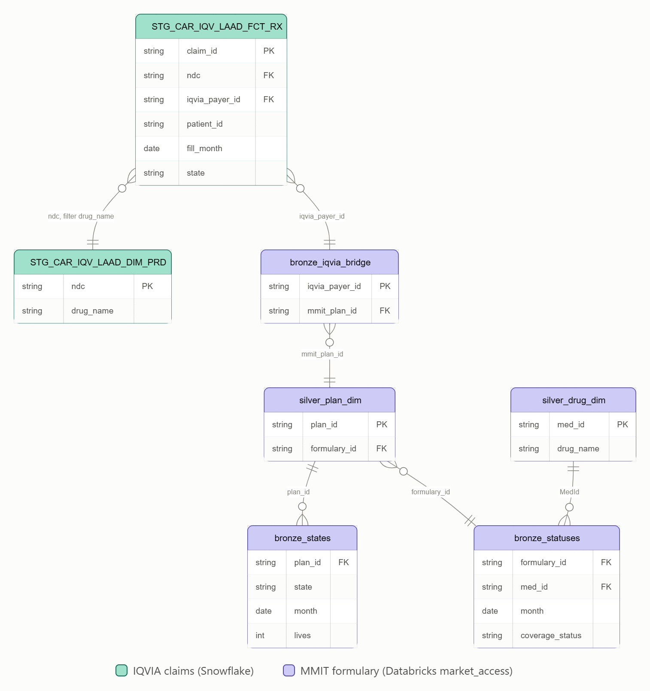
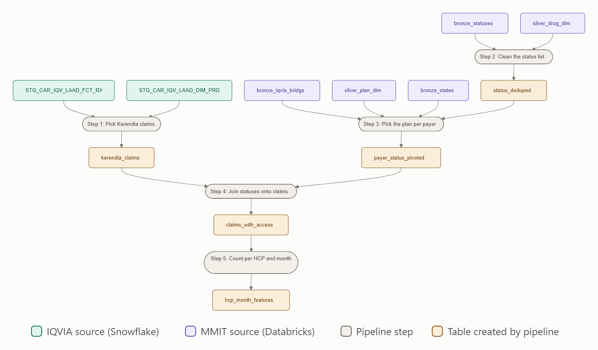

# MMIT Access Features — Notebook Walkthrough NBA 3.1

**About:** How the NBA 3.1 pipeline (built in `mmit_feature_test_notebook`) turns Kerendia claims and MMIT formulary data into HCP-level features describing each doctor's "plan environment."

---

## 1. Objective

For every Kerendia claim in the last 24 months, find what the patient's plan said about **Kerendia, Jardiance, Farxiga and Invokana** (Preferred, Covered, PA/ST, Not Covered), then aggregate to **one row per HCP per month** as features for NBA 3.1.

**Why it's tricky:**
- **Claims carry no formulary info** — only drug, doctor, date and payer ID.
- **Different ID systems** — IQVIA uses a coarse payer ID; MMIT uses finer plan IDs. One payer maps to many plans, which may disagree.
- **Different time grains** — MMIT publishes weekly; we need one status per month.

---

## 2. Data sources

### Claims world (Snowflake)

| Table | What's in it |
|---|---|
| `STG_CAR_IQV_LAAD_FCT_RX` | Every prescription claim — one row per filled script |
| `STG_CAR_IQV_LAAD_DIM_PRD` | NDC → brand name lookup (so we can find which claims are Kerendia) |

### Formulary world (Databricks `market_access`)

| Table | What's in it |
|---|---|
| `bronze_iqvia_bridge` | **The only bridge.** Maps IQVIA payer IDs to MMIT plan IDs. |
| `silver_plan_dim` | Plan → formulary (which "coverage book" each plan follows) |
| `bronze_states` | Monthly enrollment count ("lives") per plan, per state |
| `bronze_statuses` | The actual coverage status per formulary, drug, month |
| `silver_drug_dim` | Drug name → MMIT drug ID (`MedId`) |

**The pipeline walks this chain:** claim → payer → plan → formulary → coverage status for each of the 4 drugs.



---

## 3. Key IDs

| ID | Identifies | Example |
|---|---|---|
| `PROVIDER_ID` | The doctor (HCP) | 8053096 |
| `CLAIM_ID` | One prescription | C1 |
| `PAYER_PLAN_ID` | The insurer, as **IQVIA** sees it (coarse) | 7003940060 |
| `OrgId` | One specific plan, as **MMIT** sees it (fine) | 112 |
| `FormularyId` | The "coverage book" a plan follows | 59870 |
| `MedId` | A drug code in MMIT | 607231 (Kerendia) |
| `Period` / `claim_month` | A month, like 202602 | 202602 |

---

## 4. The pipeline in 5 steps

```
LEFT BRANCH: the claims              RIGHT BRANCH: what insurers cover
---------------------------          ----------------------------------
Step 1  Kerendia claims              Step 2  Clean the status list
        1 row = 1 claim                      1 row = formulary + drug + month

                                     Step 3  Pick the plan for each payer
                                             1 row = payer + month (UNIQUE)
                        \                /
                         +--- Step 4: join on payer + month ---+
                                             |
                              Step 5: count per HCP and month
```

The right branch produces **exactly one row per payer per month**, so joining it to claims never duplicates a prescription.

**Running example:** Dr. 8053096's five Kerendia claims in February 2026.

**Tables used in each step:**



All source tables are used in Steps 1–3. Steps 4 and 5 only work with tables built earlier in the pipeline.

**Running example:** Dr. 8053096's five Kerendia claims in February 2026.

---

### STEP 1 — Pick the Kerendia claims (left branch)

**What happens:**
- Pull claims Sep 2024 – Aug 2026; join `DIM_PRD` and keep brand = KERENDIA
- Add `claim_month` (`yyyyMM`) from the service date
- Cast `PAYER_PLAN_ID` to long so it matches MMIT

**Example:**

| CLAIM_ID | SVC_DT | claim_month | PAYER_PLAN_ID | Payer as long number |
|---|---|---|---|---|
| C1 | 2026-02-03 | 202602 | 7003940060 | 7003940060 |
| C2 | 2026-02-11 | 202602 | 7003940060 | 7003940060 |
| C3 | 2026-02-17 | 202602 | 0000201096 | 201096 |
| C4 | 2026-02-22 | 202602 | 7000710018 | 7000710018 |
| C5 | 2026-02-26 | 202602 | 9999999999 | 9999999999 |

> **Grain:** one row per claim (~2.6M claims).

---

### STEP 2 — Clean up the status list (right branch)

**What happens:** collapse weekly MMIT snapshots to **one status per formulary + drug + month**.
- **Pass 1:** keep the latest `feed_date` in each month
- **Pass 2:** Jardiance has two MedIds (582254, 582255) — keep the more favorable status (Preferred > Covered > PA/ST > Not Covered > Not Listed)

**Example — formulary 59870, Feb 2026:**

| MedId | Drug | feed_date | Status | Pass 1 | Pass 2 |
|---|---|---|---|---|---|
| 607231 | kerendia | 02-05 | Preferred (PA/ST) | dropped | — |
| 607231 | kerendia | 02-26 | Covered (PA/ST) | **kept** | kerendia: Covered (PA/ST) |
| 582254 | jardiance | 02-26 | Preferred | **kept** | **jardiance: Preferred** (priority 1) |
| 582255 | jardiance | 02-26 | Preferred (PA/ST) | kept | dropped (priority 6) |

> **Grain:** one row per formulary + drug + month (~101K rows).
>
> **Note:** the latest snapshot labels the whole month — a Feb 3 claim gets the Feb 26 status.

---

### STEP 3 — Pick the plan to trust for each payer (right branch)

**What happens:** a payer can map to several MMIT plans, so we pick one per payer + month, **separately for each drug**.
- Map payer → plans (`bronze_iqvia_bridge`) → formulary (`silver_plan_dim`, `is_current = true`)
- Sum lives across states per plan (`bronze_states`); plans without lives are dropped
- For each payer + month + drug, **the plan with the most lives wins**
- Pivot to one row per payer-month, one column per drug

**Example — payer 7003940060, Feb 2026, Kerendia:**

| OrgId | Plan | FormularyId | total_lives | Kerendia verdict | Result |
|---|---|---|---|---|---|
| 112 | HealthPartners MN HMO | 59870 | 2,100,000 | Covered (PA/ST) | **wins** |
| 116 | UCare Choices | 60057 | 340,000 | Preferred | out |
| 164 | Priority Health MI HMO | 59911 | 85,000 | Not Covered | out |

The same contest runs for Jardiance, Farxiga and Invokana. **Result (`payer_status_pivoted`):**

| Payer | Period | kerendia | jardiance | farxiga | invokana |
|---|---|---|---|---|---|
| 7003940060 | 202602 | Covered (PA/ST) | Preferred | Preferred | Not Covered |
| 201096 | 202602 | Not Covered | Preferred | Preferred | Not Covered |
| 7000710018 | 202602 | Preferred | Preferred | Covered (PA/ST) | Not Covered |

> **Grain:** exactly one row per payer + month — the guarantee Step 4 relies on.
>
> **Note:** a row can mix plans across drugs (fallback to next-biggest plan), and ties on lives have no tie-breaker.

---

### STEP 4 — Join the statuses onto the claims (branches meet)

**What happens:** `LEFT JOIN` claims to the pivot on payer + month, then map raw statuses to access categories.

**4a — Join**

```
C1 (payer 7003940060, 202602) --> pivot row 1 matched
C2 (payer 7003940060, 202602) --> pivot row 1 matched (same row reused — NOT duplicated)
C3 (payer 201096, 202602)     --> pivot row 2 matched
C4 (payer 7000710018, 202602) --> pivot row 3 matched
C5 (payer 9999999999, 202602) --> NO MATCH, kept by LEFT JOIN with empty statuses
```

**5 claims in, 5 claims out** — the pipeline checks this every run.

**4b — Map 11 raw statuses to 6 categories:**

| Category | Raw statuses it covers |
|---|---|
| `Covered` | Preferred, Covered, Generic (Preferred) |
| `Covered_with_PA_ST` | Covered (PA/ST), Preferred (PA/ST), Generic (Preferred) (PA/ST), Generic (PA/ST) |
| `Specialty` | Specialty |
| `Specialty_with_PA_ST` | Specialty (PA/ST) |
| `Not_Covered` | Not Covered |
| `Not_Listed` | Not Listed |
| `No_MMIT_Match` | NULL (no match) |

**Result:**

| CLAIM_ID | kerendia_access | jardiance_access | farxiga_access | invokana_access |
|---|---|---|---|---|
| C1 | Covered_with_PA_ST | Covered | Covered | Not_Covered |
| C2 | Covered_with_PA_ST | Covered | Covered | Not_Covered |
| C3 | Not_Covered | Covered | Covered | Not_Covered |
| C4 | Covered | Covered | Covered_with_PA_ST | Not_Covered |
| C5 | No_MMIT_Match | No_MMIT_Match | No_MMIT_Match | No_MMIT_Match |

> **Note:** "Preferred" collapses into `Covered` (e.g. C4), and `No_MMIT_Match` covers three cases: payer not in bridge, no data for the month, or no row for the drug.

---

### STEP 5 — Count per HCP and month

**What happens:** group by `PROVIDER_ID` + `claim_month`; count claims for 4 drugs × 6 categories (24 counters) plus `total_kerendia_claims`. `No_MMIT_Match` is not counted, so counters may not sum to the total.

**Example — 5 claims become one row:**

| PROVIDER_ID | claim_month | total_kerendia_claims | kerendia_Covered | kerendia_Covered_with_PA_ST | kerendia_Not_Covered | jardiance_Covered | farxiga_Covered | farxiga_Covered_with_PA_ST | invokana_Not_Covered |
|---|---|---|---|---|---|---|---|---|---|
| 8053096 | 202602 | 5 | 1 | 2 | 1 | 4 | 3 | 1 | 4 |

**Read as:** "5 Kerendia scripts in Feb 2026. Kerendia was unrestricted on 1, needed PA/ST on 2, not covered on 1; Jardiance was unrestricted on 4. One claim had no MMIT match."

> **Note:** `jardiance_Covered = 4` does **not** mean 4 Jardiance scripts. All counters count **Kerendia** claims, sliced by each drug's plan status.

---

## 5. Row count journey

| Stage | What one row represents | Row count |
|---|---|---|
| Step 1: `kerendia_claims` | one claim | 2,583,971 |
| Step 2: `status_deduped` | formulary + drug + month | 100,896 |
| Step 3: `payer_status_pivoted` | payer + month | 360,099 |
| Step 4: `claims_with_access` | one claim (unchanged) | **2,583,971** ← invariant |
| Step 5: `hcp_month_features` | HCP + month | 616,964 |

Step 4 must not change the row count — verified every run.

---

## 6. Open points for Wenjie

### 6.1 Decisions needed (highest impact)

| # | Point | Evidence | Proposed option |
|---|---|---|---|
| D1 | **Period coverage gap.** Statuses cover about 12 periods; claims cover 24. The usable months are the overlap of `bronze_states` and `bronze_statuses`. Documented unmatched rate 17.6%, observed 53.2%. Early months would be mostly zeros for reasons unrelated to HCP behavior. | [Observed] | First get min/max `Period` in both tables and the unmatched rate by `claim_month`. Then either restrict training to months with MMIT data, or load earlier periods if available. |
| D2 | **"Preferred" is lost.** Preferred, Covered and Generic (Preferred) collapse into `Covered`; Preferred (PA/ST) collapses into `Covered_with_PA_ST`. The call distinguished preferred from covered. | [Confirmed] | Add `Preferred` and `Preferred_with_PA_ST` as categories, or keep counters on the raw status columns. This also enables "competitor preferred on Kerendia plans" features. |
| D3 | **Three kinds of "no data" share `No_MMIT_Match`:** payer not in pivot, month not in pivot, payer matched but no row for that drug. | [Confirmed] | Split into `No_Payer_Match`, `No_Period_Match`, `No_Drug_Row`, and add a no-match counter per drug so each row reconciles. |

---

### 6.2 Design questions

| # | Point | Proposed option |
|---|---|---|
| Q1 | **Steglatro is missing.** The project scope lists five SGLT2 inhibitors; only four are evaluated. | Confirm whether to add it. |
| Q2 | **Composite rows.** Per-drug fallback can mix plans, so the Kerendia vs Jardiance comparison may come from different formularies. | Measure how often the winning `OrgId` differs across drugs. If material, choose one plan per payer × period for all drugs. |
| Q3 | **No tie-breaker on lives.** Equal-lives plans with different statuses are resolved arbitrarily and could change between runs. | Add a secondary sort key (for example lowest `OrgId`). |
| Q4 | **Jardiance optimism.** The favorable-status rule gives Jardiance an advantage Kerendia (single MedId) does not get. | Measure how often the two Jardiance codes disagree. |
| Q5 | **Ranking order.** Specialty (4) ranks above Covered PA/ST (5), and Covered PA/ST (5) above Preferred PA/ST (6). | Confirm the order is intentional. |
| Q6 | **PA and ST are not distinguished** (collapsed into one suffix). | Evaluate `silver_restriction_changes` (RestrictionCode PA, QL, ST) to separate them. |
| Q7 | **Rejected claims are counted.** No filter on `CLAIM_STATUS` or `CLAIM_TYPE`, so failed claims inflate `Not_Covered` counts. | Add paid-only counters or keep both versions. |
| Q8 | **Timing.** Statuses use the latest snapshot of the month, so a claim can carry a status not yet in effect on its service date. For NBA 3.1 (predicting the next month), features must also respect the anchor date and the 21-day data-lag buffer. | Confirm how this notebook should be anchored. |

---
