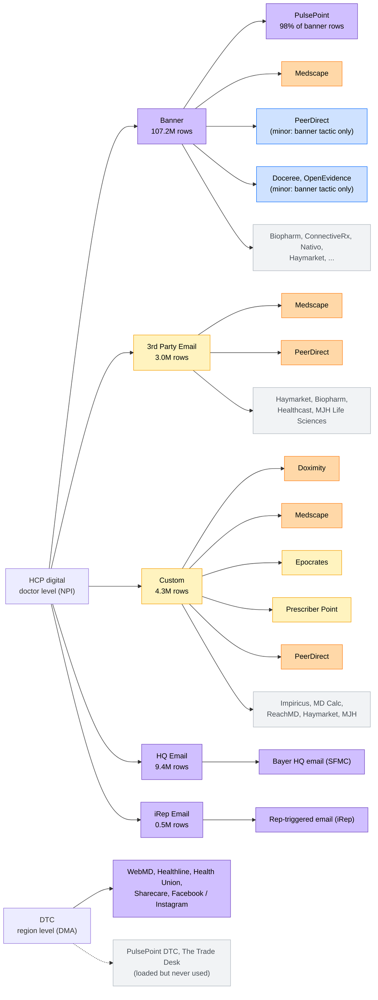
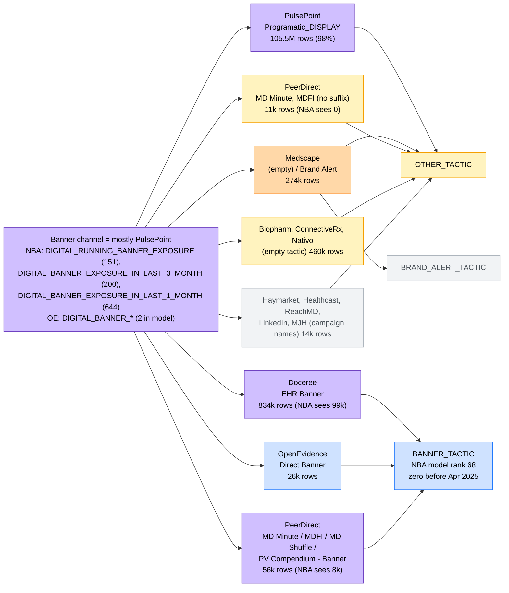
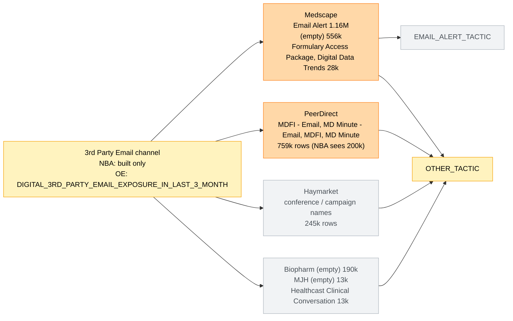
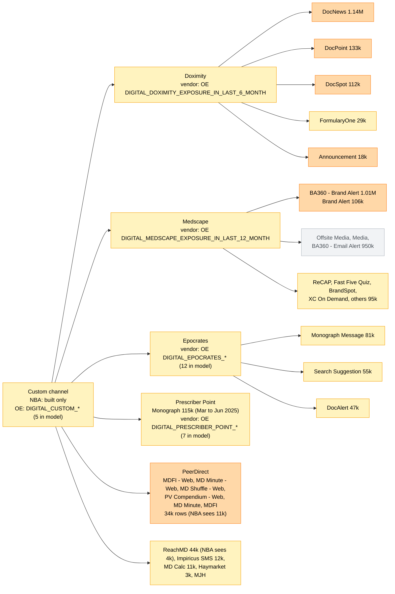
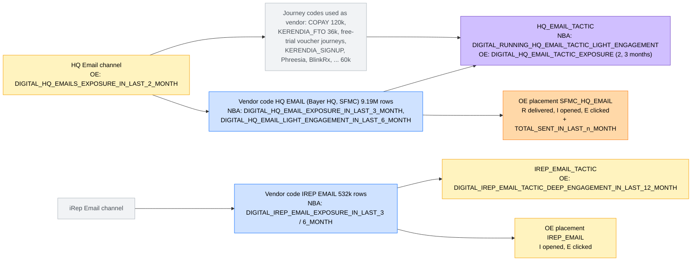
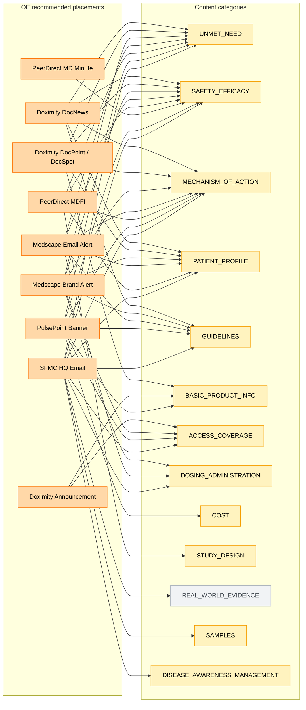
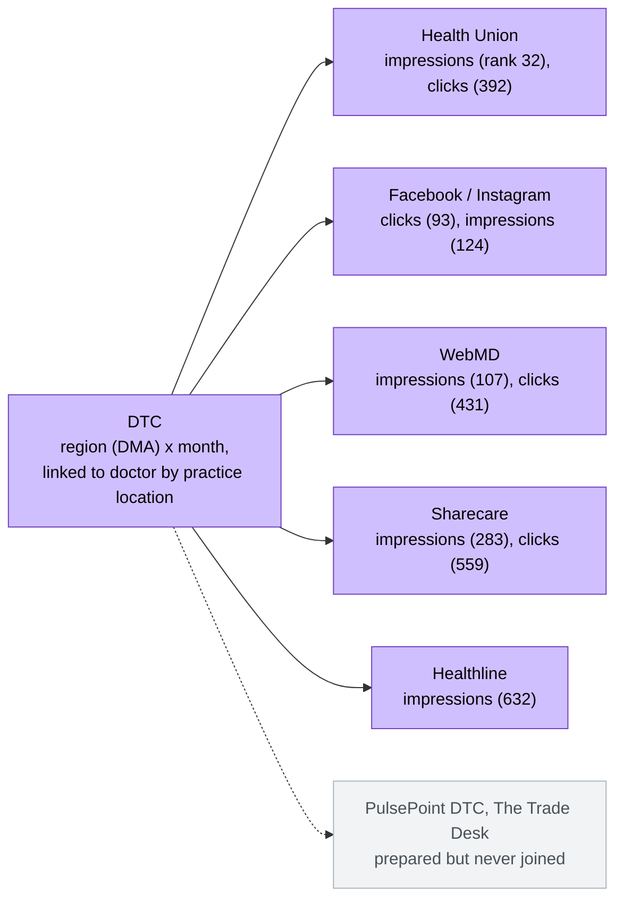

# Digital Entity Map: Vendors, Channels, Tactics and Content — with NBA 3.0 and OE 2.0 Coverage

**Group:** Non-personal promotional features (HCP digital and DTC)  
**Purpose:** one picture of how the digital operation is organised (audience → channel → vendor → tactic / placement → content → metric), and where the NBA 3.0 model and the OE 2.0 model touch it  
**Built from:** `kerendia_oe_journey.mmx_fnl_combined_aggr_tab` (all Kerendia brand values, `UPPER(BRND_NM) LIKE '%KERENDIA%'`, January 2025 to October 2026), the notebook-24-format output `kerendia_oe_journey.hcp_model_paid_search_features` (January 2023 to May 2026), `kerendia_oe_journey.content_matrix_oe_2`, the OE 2.0 training table `final_mdb_oe_2_0_22_instances_append_full`, the NBA 3.0 model run `f583bcbc9d56477fae983d44c16f8c70`, and the tactic rules of notebook `24_Features_Digital` (see `10_hcp_digital_paid_media_nba_3_0.md`)  
**Date:** October 26, 2026

**Diagrams.** The diagrams are written in Mermaid. They render in GitHub and in most Markdown viewers; if your viewer shows code instead, every diagram is followed by a table with the same information.

## 1. How to read the map

**The levels.** Every digital touch can be described by six levels. The same word ("channel") means different things in the two systems, so this map uses the names below.

| Level | Meaning | In the MMX table (NBA 3.0) | In OE 2.0 | Example |
| --- | --- | --- | --- | --- |
| Audience | Who receives it | (not a column) | (not a column) | HCP digital, DTC |
| Channel | The format group | `CHANNEL` (5 values) | (not used on its own) | Banner, 3rd Party Email, Custom, HQ Email, iRep Email |
| Vendor | The media partner or system that delivers and reports it | `SRC_SYS_CD` | `VEND_NM` | Doximity, Medscape, PulsePoint |
| Tactic / placement | The specific product of the vendor | `TACTIC_NAME`, then mapped to 15 NBA labels | `CHNL_NM_NEW`, combined with vendor (e.g. `DOXIMITY_DOCSPOT`); this is what OE calls a "channel" | DocSpot, Email Alert, MDFI - Email |
| Content | What the message is about | (none) | Content category from litcode tagging | `GUIDELINES`, `ACCESS_COVERAGE` |
| Metric | What the doctor did | `EXPOSURE`, `LIGHT_ENGAGEMENT`, `DEEP_ENGAGEMENT`, `TOTAL_ENGAGEMENT` | `R` (reach), `I` (interaction), `E` (engagement) per vendor metric | DocSpot `VIEW` = R, `VIDEO_PLAY_5S` = I, `CLICK_THROUGH` = E |

**The labels (colours in the diagrams, tags in the tables).**

| Tag | Colour | Meaning |
| --- | --- | --- |
| `NBA-M` | Blue | Used by the **NBA 3.0 model** (feature selected in run `f583bcbc...`) |
| `OE-R` | Orange | **Recommended by OE 2.0**: one of the 12 placements the OE optimiser plans and sends to vendors (also an OE model input) |
| `OE-F` | Yellow | Used by the **OE 2.0 model** as a feature or journey channel, but not recommended |
| `BOTH` | Purple | Used by both the NBA 3.0 model and the OE 2.0 model |
| `NBA-B` | Grey | NBA 3.0 **builds** features for it, but neither model uses them |

**Volumes.** "Rows" are activity rows in the MMX table (one doctor, one day, one vendor, one tactic), January 2025 to October 2026. They show relative size, not impressions.

**Brand filter.** All counts include **every Kerendia brand value** in the MMX table (`KERENDIA`, `KERENDIA HF`, `KERENDIA_HF`, `KERENDIA CKD`, `KERENDIA_CKD`, `KERENDIA-CKD`, `KERENDIA UACR`, `KERENDIAAD`, `KERENDIA-FINEARTS`, ...). NBA 3.0 notebook `24` keeps only the exact value `KERENDIA` (`UPPER(BRND_NM) = 'KERENDIA'`), so it never sees the indication-tagged rows. Where this matters, tables show **"NBA 3.0 sees"** = rows with the exact brand value. Section 6 lists what is lost.

**How tactic labels were mapped.** The rules were read from notebook `24_Features_Digital`: any name **containing** "Banner" (case-sensitive) becomes `BANNER_TACTIC`; 13 names must match **exactly** (case-sensitive, after trimming): `CTV`, `HQ Email`, `DocNews`, `Video`, `IRep Email`, `Monograph Message`, `DocSpot`, `Brand Alert`, `DocAlert`, `Email`, `Email Alert`, `NativeVideo`, `FormularyOne`; everything else, including empty names, becomes `OTHER_TACTIC`. The rules were applied to the current MMX data and **checked against the notebook-24-format output** (`hcp_model_paid_search_features`): month by month, Banner channel exposure equals PulsePoint exposure (plus small vendors), and `BANNER_TACTIC` exposure is **zero for every month before April 2025** and small afterwards.

## 2. The big picture

**What the picture shows.**

* **HCP digital** has five channels. Banner is by far the largest by rows (PulsePoint programmatic display alone is 98% of banner rows); Custom (vendor-specific programs such as Doximity DocNews or Medscape BrandAlert) and HQ email carry most of the content-rich touches.
* **NBA 3.0** uses digital only at a coarse level: the **Banner channel** (which in practice is **PulsePoint**), a small **banner tactic** total, **HQ email** and **iRep email**, plus the **DTC** consumer media. PulsePoint is the only media partner that reaches the NBA 3.0 model, and only through the channel total; no other media partner (Doximity, Medscape, PeerDirect, ...) or placement is used.
* **OE 2.0** works at the **vendor + placement** level for Doximity, Medscape, PeerDirect, PulsePoint and SFMC (these are the placements it recommends), and uses MMX totals for Epocrates and Prescriber Point, which it does not recommend.
* **DTC** is a separate world: region-level consumer media. Both models use the same 9 DTC features.

## 3. Channel by channel

### 3.1 Banner

| Vendor | Tactic name in MMX | Rows (all Kerendia) | NBA 3.0 sees (exact brand) | NBA tactic label | NBA 3.0 | OE 2.0 |
| --- | --- | --- | --- | --- | --- | --- |
| PulsePoint | `Programatic_DISPLAY` | 105.5M | 105.5M | `OTHER_TACTIC` | `BOTH`: the Banner **channel** features in the model (ranks 151, 200, 644) are in practice PulsePoint | `OE-R` `PULSEPOINT_BANNER` (R impressions, I clicks) |
| Medscape | (empty), `Brand Alert` | 274k | 274k | `OTHER_TACTIC`, `BRAND_ALERT_TACTIC` | Banner channel total only (small share) | `OE-R` `MEDSCAPE_BANNER` |
| Doceree | `EHR Banner` | 834k | 99k | `BANNER_TACTIC` | `NBA-M` through the banner tactic (rank 68) | `OE-F` journey `DOCEREE_BANNER` |
| OpenEvidence | `Direct Banner` | 26k | 26k | `BANNER_TACTIC` | `NBA-M` through the banner tactic | not used |
| PeerDirect | `MD Minute - Banner`, `MDFI - Banner`, `MD Shuffle - Banner`, `PV Compendium Quiz Series - Banner`, `PV Compendium Quiz Edition - Banner` | 56k | 8k | `BANNER_TACTIC` | `NBA-M` through the banner tactic | `OE-F` journey `PEERDIRECT_MDFI_BANNER`, `PEERDIRECT_MD_MINUTE_BANNER` |
| PeerDirect | `MD Minute`, `MDFI` (no "- Banner" suffix) | 11k | 0 | `OTHER_TACTIC` | not seen (brand filter) | same placements as above |
| Biopharm, ConnectiveRx, Nativo | (empty) | 460k | 460k | `OTHER_TACTIC` | Banner channel total only | `OE-F` journey `NATIVO_BANNER` |
| Haymarket, Healthcast, ReachMD, LinkedIn, MJH | campaign names, `Impression`, `PP SMART PIXEL` | 14k | 14k | `OTHER_TACTIC` | Banner channel total only | not used |

**Key points.**

* **NBA 3.0's banner signal is PulsePoint.** Three of the four banner features in the NBA 3.0 model are Banner **channel** totals (`DIGITAL_RUNNING_BANNER_EXPOSURE`, `DIGITAL_BANNER_EXPOSURE_IN_LAST_3_MONTH`, `DIGITAL_BANNER_EXPOSURE_IN_LAST_1_MONTH`). In the notebook-24-format output, Banner channel exposure equals PulsePoint exposure every month from January 2023 to May 2026, apart from small amounts from other vendors since mid-2025.
* **The banner *tactic* is not PulsePoint.** PulsePoint's tactic name (`Programatic_DISPLAY`) does not contain "Banner", so it goes to `OTHER_TACTIC`. `DIGITAL_BANNER_TACTIC_EXPOSURE_IN_LAST_3_MONTH` (rank 68) comes from Doceree, OpenEvidence and PeerDirect banners. It is **zero for every doctor before April 2025** and small afterwards, so in a model trained over that history it mostly marks the recent period rather than banner pressure.
* **The brand filter hides most Doceree and PeerDirect banners.** NBA 3.0 sees 99k of 834k Doceree rows and 8k of 67k PeerDirect banner rows; the rest is tagged `KERENDIA HF`, `KERENDIA CKD`, `KERENDIA UACR`, `KERENDIA_HF` or `KERENDIA_CKD`.

### 3.2 3rd Party Email

| Vendor | Tactic name in MMX | Rows (all Kerendia) | NBA 3.0 sees (exact brand) | NBA tactic label | NBA 3.0 | OE 2.0 |
| --- | --- | --- | --- | --- | --- | --- |
| Medscape | `Email Alert` | 1.16M | 1.16M | `EMAIL_ALERT_TACTIC` | `NBA-B` | `OE-R` `MEDSCAPE_3RD_PARTY_EMAIL` (R delivery, I open, E click) |
| Medscape | (empty), `Formulary Access Package`, `Digital Data Trends` | 584k | 584k | `OTHER_TACTIC` | `NBA-B` | same placement as above |
| PeerDirect | `MDFI - Email` | 474k | 166k | `OTHER_TACTIC` | `NBA-B` | `OE-R` `PEERDIRECT_MDFI_EMAIL` (R) |
| PeerDirect | `MD Minute - Email` | 229k | 33k | `OTHER_TACTIC` | `NBA-B` | `OE-R` `PEERDIRECT_MD_MINUTE_EMAIL` (R) |
| PeerDirect | `MD Minute`, `MDFI` (no suffix) | 57k | 0 | `OTHER_TACTIC` | not seen (brand filter) | same placements as above |
| Haymarket | conference and campaign names (AHA, HFSA, ...) | 245k | 245k | `OTHER_TACTIC` | `NBA-B` | not used |
| Biopharm, MJH Life Sciences, Healthcast | (empty), `Clinical Conversation` | 215k | 215k | `OTHER_TACTIC` | `NBA-B` | `OE-F` journey `MJHLIFESCIENCES_3RD_PARTY_EMAIL` |

**Key points.**

* NBA 3.0 uses nothing from 3rd-party email. OE uses it at two levels: the MMX channel total, and event-level open / click counts for Medscape and PeerDirect, which it also recommends.
* PeerDirect email is mostly tagged by indication (`KERENDIA_HF`, `KERENDIA_CKD`): NBA 3.0 sees only about a quarter of it (200k of 759k rows).

### 3.3 Custom (vendor-specific programs)

| Vendor | Tactic name in MMX | Rows | NBA tactic label | NBA 3.0 | OE 2.0 |
| --- | --- | --- | --- | --- | --- |
| Doximity | `DocNews` | 1.14M | `DOCNEWS_TACTIC` | `NBA-B` | `OE-R` `DOXIMITY_DOCNEWS` (R headline view; also DocNews email R) |
| Doximity | `DocPoint` | 133k (NBA sees 131k) | `OTHER_TACTIC` | `NBA-B` | `OE-R` `DOXIMITY_DOCPOINT` (R view, I video 5s, E click-through) |
| Doximity | `DocSpot` | 112k | `DOCSPOT_TACTIC` | `NBA-B` | `OE-R` `DOXIMITY_DOCSPOT` (R view, I video 5s, E click-through) |
| Doximity | `FormularyOne` | 29k | `FORMULARY_TACTIC` | `NBA-B` | `OE-F` journey `DOXIMITY_FORMULARYONE` |
| Doximity | `Announcement` | 18k | `OTHER_TACTIC` | `NBA-B` | `OE-R` `DOXIMITY_ANNOUNCEMENT` |
| Medscape | `BA360 - Brand Alert`, `Brand Alert` | 1.12M | `OTHER_TACTIC`, `BRAND_ALERT_TACTIC` | `NBA-B` | `OE-R` `MEDSCAPE_BRANDALERT` |
| Medscape | `Offsite Media`, `Media`, `BA360 - Email Alert`, (empty) | 1.23M | `OTHER_TACTIC` | `NBA-B` | vendor total only (`OE-F`) |
| Medscape | `Research Capsule (ReCAP)`, `Fast Five Quiz`, `BrandSpot`, `XC On Demand`, `Digital Data Trends`, `Formulary Access Package` | 95k | `OTHER_TACTIC` | `NBA-B` | `OE-F` journey `MEDSCAPE_RECAP`, `MEDSCAPE_FFQ`, `MEDSCAPE_BRANDSPOT`, `MEDSCAPE_XCOD` |
| Epocrates | `Monograph Message` | 81k | `MONOGRAPH_MESSAGE_TACTIC` | `NBA-B` | `OE-F` vendor (12) + monograph tactic (3) features; journey `EPOCRATES_MONOGRAPH_MESSAGE` |
| Epocrates | `Search Suggestion` | 55k | `OTHER_TACTIC` | `NBA-B` | `OE-F` journey `EPOCRATES_SEARCH_SUGGESTIONS` |
| Epocrates | `DocAlert` | 47k | `DOC_ALERT_TACTIC` | `NBA-B` | `OE-F` journey `EPOCRATES_DOCALERT` |
| Prescriber Point | `Monograph` | 115k | `OTHER_TACTIC` | `NBA-B` | `OE-F` vendor features (7) |
| PeerDirect | `MDFI - Web`, `MD Minute - Web`, `MD Shuffle - Web`, `PV Compendium Quiz Series - Web`, `PV Compendium Quiz Edition - Web`, `MD Minute`, `MDFI` | 34k (NBA sees 11k) | `OTHER_TACTIC` | `NBA-B` | `OE-R` `PEERDIRECT_MDFI_WEB`; `OE-F` journey `PEERDIRECT_MD_MINUTE_WEB` |
| ReachMD, Impiricus, MD Calc, Haymarket, MJH | `Email`, `Page View`, `Transcript`, `SMS Messages`, `MDSpotlight`, ... | 71k (NBA sees 31k; ReachMD 44k, of which NBA sees 4k) | mostly `OTHER_TACTIC` (`Email` → `EMAIL_TACTIC`) | `NBA-B` | `OE-F` journey `IMPIRICUS_MOBILE`, `MD_CALC_BRANDALERT`, `REACHMD_EMAIL`, `REACHMD_DESKTOP` |

**Key points.**

* Custom is where most **recommended** OE placements live (Doximity DocNews / DocPoint / DocSpot / Announcement, Medscape BrandAlert, PeerDirect MDFI web). NBA 3.0 uses nothing from this channel.
* Several of the most important placements fall into NBA's `OTHER_TACTIC`: Medscape `BA360 - Brand Alert` (1.01M rows), Doximity `DocPoint`, Prescriber Point `Monograph`, all PeerDirect web. `OTHER_TACTIC` is therefore a mixture, which may explain why OE's feature selection kept 8 `OTHER_TACTIC` features without knowing what they represent.
* Epocrates and Prescriber Point are strong in OE's model (19 features together) but are **not** recommended by OE: OE learns from them but does not plan them.

### 3.4 HQ Email and iRep Email

| Entity | Rows | NBA 3.0 | OE 2.0 |
| --- | --- | --- | --- |
| HQ email, vendor code `HQ EMAIL` | 9.19M | `NBA-M`: `DIGITAL_HQ_EMAIL_EXPOSURE_IN_LAST_3_MONTH` (rank 688), `DIGITAL_HQ_EMAIL_LIGHT_ENGAGEMENT_IN_LAST_6_MONTH` (695) | `OE-R` `SFMC_HQ_EMAIL` (R / I / E), `TOTAL_SENT_IN_LAST_2/3/6/12_MONTH` |
| HQ email, journey codes in the vendor column (`COPAY`, `KERENDIA_FTO`, voucher journeys, ...) | 180k | counted in the HQ email channel and tactic | not separately |
| HQ email tactic (`HQ_EMAIL_TACTIC`) | 9.37M | `NBA-M`: `DIGITAL_RUNNING_HQ_EMAIL_TACTIC_LIGHT_ENGAGEMENT` (698) | `OE-F`: `DIGITAL_HQ_EMAIL_TACTIC_EXPOSURE_IN_LAST_2/3_MONTH` |
| HQ email channel | 9.37M | `NBA-B` | `OE-F`: `DIGITAL_HQ_EMAILS_EXPOSURE_IN_LAST_2_MONTH` |
| iRep email, vendor code `IREP EMAIL` | 532k | `NBA-M`: `DIGITAL_IREP_EMAIL_EXPOSURE_IN_LAST_6_MONTH` (738), `..._3_MONTH` (743) | `OE-F` event `IREP_EMAIL` (I opened, E clicked) |
| iRep email tactic | 532k | `NBA-B` (see note below) | `OE-F`: `DIGITAL_IREP_EMAIL_TACTIC_DEEP_ENGAGEMENT_IN_LAST_12_MONTH` |

**Key points.**

* In the MMX table, HQ email and iRep email appear as **vendors** (`SRC_SYS_CD` = `HQ EMAIL`, `IREP EMAIL`), so the NBA 3.0 features `DIGITAL_HQ_EMAIL_*` and `DIGITAL_IREP_EMAIL_*` are vendor-level features for Bayer's own email systems, not for a media partner.
* For HQ email, the vendor column also holds **journey codes** (`COPAY`, `KERENDIA_FTO`, free-trial vouchers, ...). These look like separate vendors in NBA's vendor pivot.
* iRep email is sent by reps, so OE uses it as an input but does not recommend it.
* **Watch the iRep tactic name.** Notebook `24` matches `IRep Email` exactly (case-sensitive). The current MMX table spells it `iRep Email`, which would send all iRep activity to `OTHER_TACTIC`. The notebook's April 2026 run still produced `IREP_EMAIL_TACTIC` columns, so the spelling may have changed since then; check before the next run.

## 4. Content layer (OE 2.0 only)

NBA 3.0 has no content dimension. OE tags each message with a content category (from litcode, subject line, creative, ...), and its content matrix (`content_matrix_oe_2`) defines which categories each recommended placement can carry.

**Content allowed per placement** (`content_matrix_oe_2`; X = at least one content item):

| Placement | UNMET_NEED | SAFETY_EFFICACY | MECHANISM_OF_ACTION | PATIENT_PROFILE | GUIDELINES | BASIC_PRODUCT_INFO | ACCESS_COVERAGE | DOSING_ADMINISTRATION | COST | STUDY_DESIGN | REAL_WORLD_EVIDENCE | SAMPLES | DISEASE_AWARENESS_MANAGEMENT |
| --- | --- | --- | --- | --- | --- | --- | --- | --- | --- | --- | --- | --- | --- |
| Doximity DocNews | X | X | X | X | X | | | | | | | | |
| Doximity DocPoint | X | X | X | X | | X | | | | | | | |
| Doximity DocSpot | X | X | X | X | | X | | | | | | | |
| Doximity Announcement | | | | | | X | X | | | | | | |
| Medscape Brand Alert | X | X | X | X | X | | X | X | | | | | |
| Medscape Email Alert | X | X | X | X | X | | | X | | | | | |
| PeerDirect MDFI | X | X | X | X | | | | | | X | | | |
| PeerDirect MD Minute | | X | | | | | | | | | | | |
| PeerDirect MD Shuffle | X | | | | | | | | | | | | |
| PulsePoint Banner | X | X | X | | X | X | X | | X | | | | |
| SFMC HQ Email | X | X | X | X | X | | X | X | | | X | X | |
| SFMC Email 1 to 6 | | | | | | | | | | | | | X |

**How content enters the OE 2.0 model.** 13 content counts over the previous 3 months are model features (`UNMET_NEED_COUNT_P3`, `GUIDELINES_COUNT_P3`, ..., plus `GENERAL_COUNT_P3` for untagged touches). `REAL_WORLD_EVIDENCE` can be sent (SFMC HQ email) but is **not** one of the model's content features; it appears only in the journey. The journey input carries 21 content categories in total.

**Gaps between the matrix and the 12 recommended placements.** Medscape Banner and PeerDirect MDFI web are recommended but have no rows of their own in the content matrix (MDFI content is shared between email and web); PeerDirect MD Shuffle has content rows but is not one of the 12 recommended placements.

## 5. DTC (consumer media)

| Vendor | Measures | NBA 3.0 model (rank of 752) | OE 2.0 model |
| --- | --- | --- | --- |
| Health Union | impressions, clicks | 32, 392 | both kept |
| Facebook / Instagram | clicks, impressions | 93, 124 | both kept |
| WebMD | impressions, clicks | 107, 431 | both kept |
| Sharecare | impressions, clicks | 283, 559 | both kept |
| Healthline | impressions | 632 | kept |
| PulsePoint DTC, The Trade Desk | (loaded and prepared) | never added to the table | not used |

**Key point.** DTC is the only area where NBA 3.0 and OE 2.0 use exactly the same features (9 each). DTC is at the region level, so it describes the doctor's area rather than the doctor; OE does not recommend DTC.

## 6. What NBA 3.0 does not see: the brand filter

Notebook `24` keeps only `UPPER(BRND_NM) = 'KERENDIA'`. Kerendia rows tagged with an indication or program are dropped. HQ email, iRep email, PulsePoint, Medscape, Epocrates and Prescriber Point are not affected; the loss is concentrated in three vendors.

| Channel | Vendor | Rows (all Kerendia) | NBA 3.0 sees | Share lost | Brand values dropped |
| --- | --- | --- | --- | --- | --- |
| Banner | Doceree | 834k | 99k | 88% | `KERENDIA HF`, `KERENDIA CKD`, `KERENDIA UACR` |
| 3rd Party Email | PeerDirect | 759k | 200k | 74% | `KERENDIA_HF`, `KERENDIA_CKD` |
| Banner | PeerDirect | 67k | 8k | 89% | `KERENDIA_HF`, `KERENDIA_CKD` |
| Custom | PeerDirect | 34k | 11k | 68% | `KERENDIA_HF`, `KERENDIA_CKD`, `KERENDIA-HF` |
| Custom | ReachMD | 44k | 4k | 91% | `KERENDIAAD`, `KERENDIA-CKD`, `KERENDIA-FINEARTS`, `KERENDIA-FINEONE` |
| Custom | Doximity | 1.43M | 1.43M | 0.1% | `KERENDIA HF` (DocPoint) |
| All HCP digital | | 124.3M | 122.9M | 1.1% | |

**Why it matters.** The loss is small in total but large for the vendors concerned: most of PeerDirect (an OE-recommended partner) and most of Doceree (the main source of NBA's banner tactic feature) never reach NBA 3.0. Some tactic names exist only under these brand values (`MDFI`, `MD Minute` without a suffix, `PV Compendium Quiz Edition - Banner`), so NBA 3.0 has never seen them. For NBA 3.1, use `UPPER(BRND_NM) LIKE '%KERENDIA%'` (as the Digital refresh notebook already does) and, if useful, keep the indication (HF / CKD / UACR) as a separate dimension.

## 7. Coverage summary

| Level | NBA 3.0 model uses | OE 2.0 model uses | OE 2.0 recommends |
| --- | --- | --- | --- |
| Channel | Banner (in practice PulsePoint) | Banner, 3rd Party Email, Custom, HQ Email | (none at channel level) |
| Vendor | `HQ EMAIL`, `IREP EMAIL` (Bayer's own systems); PulsePoint only indirectly, through the Banner channel | Doximity, Medscape, Epocrates, Prescriber Point (MMX); Doximity, Medscape, PeerDirect, PulsePoint, SFMC, iRep (event level) | Doximity, Medscape, PeerDirect, PulsePoint, SFMC |
| Tactic / placement | `BANNER_TACTIC` (Doceree, OpenEvidence, PeerDirect; zero before April 2025), `HQ_EMAIL_TACTIC` | `OTHER_TACTIC`, `HQ_EMAIL_TACTIC`, `MONOGRAPH_MESSAGE_TACTIC`, `IREP_EMAIL_TACTIC`; 51 journey placements; 12 event-level placements with R / I / E | 12 placements |
| Content | none | 13 content counts; 21 categories in the journey | 14 categories |
| Metric | exposure, light engagement | R, I, E per vendor metric; touchpoint totals | (planned touches) |
| DTC | 9 features | same 9 features | none |

**What this means for NBA 3.1.**

* NBA 3.0 sees digital through a **keyhole**: one channel total (Banner, which is effectively PulsePoint), a small banner tactic that excludes PulsePoint, and Bayer's own emails. PulsePoint is the only OE-recommended partner that reaches the NBA 3.0 model, and only as a channel total without placement or content; the Doximity, Medscape and PeerDirect placements OE recommends are invisible to it.
* The exact brand filter removes most PeerDirect and Doceree activity before any feature is built (section 6).
* `OTHER_TACTIC` hides large and important placements (Medscape BA360 Brand Alert, PulsePoint display, Doximity DocPoint, Prescriber Point, PeerDirect web). A fixed vendor + placement list, as OE uses, would make these visible and stable.
* Content exists only on the OE side. Reusing OE's content tagging is the only way for NBA to know what a touch was about.

## 8. Sources and how to refresh

| Item | Source |
| --- | --- |
| Channel, vendor, tactic and row counts | `kerendia_oe_journey.mmx_fnl_combined_aggr_tab`, `UPPER(BRND_NM) LIKE '%KERENDIA%'` (with the exact-`KERENDIA` subset shown as "NBA 3.0 sees"), channels other than Call and Sample, January 2025 to October 2026 |
| NBA tactic labels | Rules read from notebook `24_Features_Digital` (`/Users/wenjie.chen@bayer.com/kerendia_nba_3_0_develop/NBA 3.0 Ops - Pipeline/03_Feature_Engineering/03_HCP_Level_Features/24_Features_Digital`), applied to current MMX data |
| Check of banner channel versus banner tactic | `kerendia_oe_journey.hcp_model_paid_search_features` (OE's copy of the notebook 24 output; same tactic rules), monthly sums January 2023 to May 2026 |
| NBA 3.0 model features and ranks | MLflow run `f583bcbc9d56477fae983d44c16f8c70`, artifact `Shap_Importances.csv` |
| OE 2.0 model features | Columns of `kerendia_oe_journey.final_mdb_oe_2_0_22_instances_append_full` (champion model `bayer_kerendia_ga_model_oe_2@champion`) |
| OE journey placements and recommended placements | OE 2.0 model configuration (51 journey channels, 12 recommended); see `12_hcp_oe_digital_review_for_nba_3_1.md` |
| Content per placement | `kerendia_oe_journey.content_matrix_oe_2` |
| DTC | `20_dtc_direct_buy_social_nba_3_0.md` |
